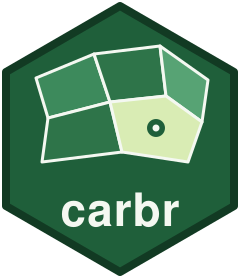

# carbr 

[](https://github.com/castlaboratory/carbr-py/actions/workflows/ci.yml)
[](https://pypi.org/project/carbr/)
[](LICENSE)
[](https://doi.org/10.5281/zenodo.24532757)

Os imóveis rurais declarados no **Cadastro Ambiental Rural (CAR)** no Python, sem
baixar a base inteira.

O `carbr` lê uma republicação dos dados públicos do Sicar em GeoParquet. Cada
consulta — por UF, município, situação, porte, retângulo, ponto ou código do
imóvel — transfere só os trechos do arquivo de que precisa, e não passa pelos
servidores do Sicar.

Além do cadastro, a publicação traz indicadores por imóvel (sobreposição entre cadastros, terras
indígenas e unidades de conservação), uma tipologia dos municípios e resumos do país já calculados.
Para conferir um imóvel de cada vez na tela, há o portal oficial
[Consulta Pública](https://consulta.car.gov.br), do Sicar; o `carbr` é para quem precisa dos dados
dentro de um programa.

**Documentação:** <https://castlaboratory.github.io/carbr-py/>

**Consulta no navegador, sem instalar nada:** <https://car.castlab.org/index.html>

## Instalação

```bash
pip install "carbr[geo]"
```

Sem o extra `geo`, a geometria vem em WKB e `car_at()` não está disponível.

## Uso

```python
import carbr

carbr.car_catalog()                       # UFs publicadas, versão e qualidade da carga
carbr.car_summary(["state", "size_class"])   # totais do país, sem ler os imóveis
carbr.car_municipalities("PE")            # resumo por município

# Imóveis grandes de Petrolina, como GeoDataFrame
carbr.car_properties("PE", municipality="Petrolina", size_class="large")

# Cadastros pendentes do estado, sem transferir a geometria
carbr.car_properties("PE", status="pending", geometry=False)

carbr.car_at(lon=-40.5, lat=-9.2)         # que imóveis estão declarados neste ponto?
carbr.car_property("PE-2611101-588BC484570D440484F527F07DF5AFFA")
carbr.car_check(codigos)                  # triagem: situação, áreas protegidas, embargos, florestas públicas
carbr.car_quality_summary()               # indicadores por município, o país inteiro
carbr.car_typology()                      # o perfil de cada município

# Qualquer outra consulta, direto no arquivo remoto
carbr.car_tbl("PE").aggregate("status, size_class, count(*) AS n").df()
```

## Guias

- [Primeiros passos](https://castlaboratory.github.io/carbr-py/primeiros-passos/)
- [Inconsistências do cadastro](https://castlaboratory.github.io/carbr-py/inconsistencias/): sobreposições entre imóveis, terras indígenas e unidades de conservação, o confronto com o Sigef do Incra e a área declarada maior que o território.
- [Onde a análise está parada](https://castlaboratory.github.io/carbr-py/fila-da-analise/): as etapas da análise por UF, quem aguarda resposta à notificação e a tipologia dos municípios.
- [Triagem para crédito e conformidade](https://castlaboratory.github.io/carbr-py/triagem/): a conferência em lote dos impedimentos do crédito rural, com os mapas de embargos e de florestas públicas.

## Assistentes

O pacote traz um servidor MCP: um assistente compatível passa a responder perguntas sobre o CAR com os
dados reais. Veja [Assistentes (MCP)](https://castlaboratory.github.io/carbr-py/assistentes/).

```bash
uvx --from "carbr[mcp]" carbr-mcp
```

## Os dados

- **Origem:** serviço público do Sicar, do Serviço Florestal Brasileiro. O cadastro é
  autodeclarado: há sobreposições entre imóveis, e a presença no CAR não comprova domínio.
- **Conteúdo:** o perímetro declarado e dez atributos de cada imóvel. Não há dado pessoal.
- **Base normativa:** a Instrução Normativa MMA nº 3, de 18/12/2014, garante o livre acesso às
  informações não sigilosas e não pessoais do Sicar (arts. 12 e 18). São sigilosas as que
  identificam proprietários ou possuidores ou os associam aos imóveis (art. 4º); nenhuma delas
  está nesta publicação.
- **Finalidade:** pela mesma norma (art. 2º), as informações do CAR se destinam a subsidiar
  políticas, programas, projetos e atividades de controle, monitoramento, planejamento ambiental
  e econômico e combate ao desmatamento. O uso para outros fins que cause dano a terceiros pode
  gerar responsabilização.
- **Sem caráter oficial:** é uma republicação independente, feita pelo CastLab/UFPE. Não é um
  produto do Serviço Florestal Brasileiro nem substitui o Sicar; em caso de divergência, vale o
  Sicar.
- **Cobertura:** as 27 UFs, cerca de 8,6 milhões de imóveis. `car_catalog()` mostra o que está
  publicado e a data.
- **Endereço:** o padrão é um bucket público; `carbr.set_base_url()` ou a variável `CAR_URL`
  apontam para um espelho compatível com S3 ou para uma pasta local.

As mesmas funções existem em R: [carbr-r](https://github.com/castlaboratory/carbr-r).

## Como citar

O pacote está arquivado no Zenodo: [doi:10.5281/zenodo.24532757](https://doi.org/10.5281/zenodo.24532757) (o DOI aponta sempre para a
versão mais recente). Os dados são do Sicar; use `car_cite()` para citá-los.

## Licença

Código sob licença MIT.
