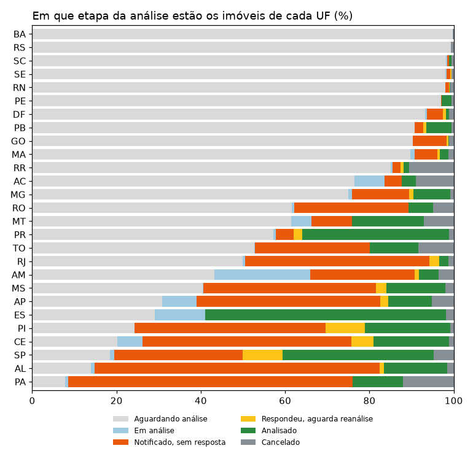
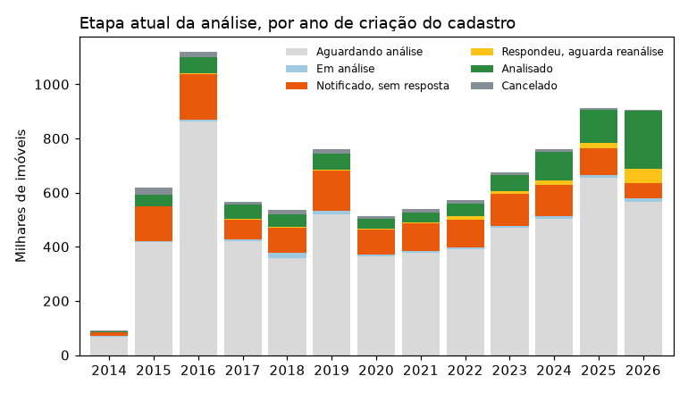
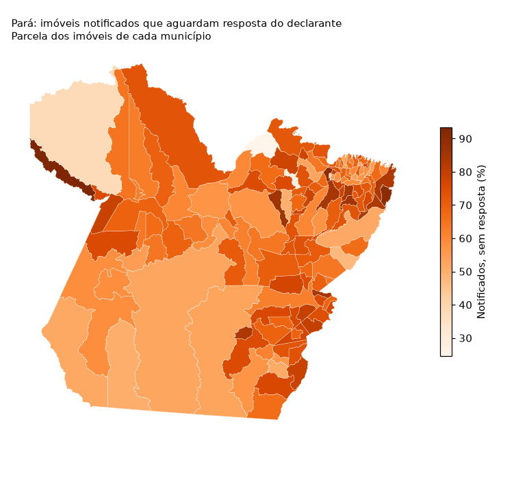

# Onde a análise está parada

Cadastrar foi a parte rápida: o país tem mais de 8,5 milhões de imóveis no CAR. A
regularização depende do passo seguinte — o órgão estadual analisar o cadastro e o
produtor responder ao que a análise pede. Este guia usa a coluna `condition`, a etapa
da análise informada pelo Sicar, para mostrar onde cada UF está e quem espera por quem.

Tudo aqui sai do resumo pré-calculado (`car_summary()`), em segundos, menos o mapa do
fim, que lê duas colunas de um estado.

## As etapas

O Sicar informa quinze situações de análise. Agrupadas em seis etapas:

```python
import carbr

STAGES = ["Aguardando análise", "Em análise", "Notificado, sem resposta",
          "Respondeu, aguarda reanálise", "Analisado", "Cancelado"]


def stage(condition):
    if condition.startswith("Cancelado"):
        return "Cancelado"
    if condition == "Aguardando análise":
        return "Aguardando análise"
    if condition == "Em análise":
        return "Em análise"
    if "aguardando atendimento a notificação" in condition:
        return "Notificado, sem resposta"
    if "após revisão" in condition:
        return "Respondeu, aguarda reanálise"
    return "Analisado"


def by_stage(*by):
    df = carbr.car_summary(["condition", *by])
    df["stage"] = pd.Categorical(df["condition"].map(stage), STAGES)
    return df.groupby([*by, "stage"], observed=False)["properties"].sum().reset_index()


national = by_stage()
national["share"] = (100 * national["properties"] / national["properties"].sum()).round(1)

national
```

```text
                          stage  properties  share
0            Aguardando análise     5978543   69.7
1                    Em análise      109335    1.3
2      Notificado, sem resposta     1309315   15.3
3  Respondeu, aguarda reanálise      134338    1.6
4                     Analisado      874463   10.2
5                     Cancelado      172067    2.0
```

Sete em cada dez cadastros ainda não foram analisados. Dos que foram, a maior parte
parou no passo seguinte: há mais imóveis notificados à espera de resposta do
declarante do que imóveis com análise concluída.

## A fila não é a mesma em cada UF

```python
palette = {"Aguardando análise": "#d9d9d9", "Em análise": "#9ecae1",
           "Notificado, sem resposta": "#e8590c", "Respondeu, aguarda reanálise": "#fcc419",
           "Analisado": "#2b8a3e", "Cancelado": "#868e96"}
states = by_stage("state").pivot(index="state", columns="stage", values="properties")
shares = states.div(states.sum(axis=1), axis=0).sort_values("Aguardando análise")

ax = (100 * shares).plot.barh(stacked=True, figsize=(7, 6.8), width=0.8,
                              color=[palette[s] for s in shares.columns])
ax.set_title("Em que etapa da análise estão os imóveis de cada UF (%)", loc="left")
ax.set_xlim(0, 100)
ax.set_ylabel("")
ax.legend(ncol=2, frameon=False, loc="upper center", bbox_to_anchor=(0.5, -0.05), fontsize=8)

fig("etapas")
```



Há três situações bem diferentes. Em parte dos estados quase nada foi analisado
(cinza). Em alguns a análise andou e concluiu (verde). E em outros a análise andou,
mas parou na notificação (laranja): o órgão fez a sua parte e a resposta não veio.

```python
notified = states["Notificado, sem resposta"].sort_values(ascending=False).to_frame("properties")
notified["share_of_state"] = (100 * shares["Notificado, sem resposta"]).round(1)
top5 = 100 * notified["properties"].head(5).sum() / notified["properties"].sum()
print(f"As cinco primeiras UFs concentram {top5:.0f}% das notificações sem resposta")

notified.head(8)
```

```text
As cinco primeiras UFs concentram 71% das notificações sem resposta
       properties  share_of_state
state                            
PA         265238            67.5
CE         203419            49.5
MG         161094            13.6
PI         153090            45.3
SP         144251            30.4
AL          97264            67.6
RO          53743            27.1
MS          37014            40.9
```

## Quem está sem responder

```python
waiting = by_stage("size_class")
waiting = waiting[waiting["stage"] == "Notificado, sem resposta"].drop(columns="stage")
waiting["share"] = (100 * waiting["properties"] / waiting["properties"].sum()).round(1)

waiting
```

```text
   size_class  properties  share
2       large       27771    2.1
8      medium       86308    6.6
14      small     1195236   91.3
```

Nove em cada dez são imóveis de até quatro módulos fiscais. É o público que menos tem
acesso a técnico, a ferramenta de geoprocessamento e a quem explique o relatório da
análise — e para quem a pendência no CAR pesa no crédito rural.

## A notificação envelhece

Pelo ano de criação do cadastro, a resposta não chega com o tempo: de cada ano desde
2015, entre um oitavo e um quinto dos cadastros está parado na notificação, e os mais
antigos não estão em situação melhor.

```python
years = by_stage("created_year").pivot(index="created_year", columns="stage", values="properties")

ax = (years / 1e3).plot.bar(stacked=True, figsize=(7, 4), width=0.85, rot=0,
                            color=[palette[s] for s in years.columns])
ax.set_title("Etapa atual da análise, por ano de criação do cadastro", loc="left")
ax.set_xlabel("")
ax.set_ylabel("Milhares de imóveis")
ax.legend(ncol=2, frameon=False, fontsize=8)

fig("analise-anos")
```



## Onde, dentro de um estado

O resumo vai até a UF. Para descer ao município, `car_tbl()` lê só as duas colunas
necessárias do arquivo do estado. No Pará, a UF com mais notificações sem resposta:

```python
para = carbr.car_tbl("PA").aggregate(
    "municipality_code, municipality, condition, count(*) AS n"
).df()
para["notified"] = para["n"].where(para["condition"].map(stage) == "Notificado, sem resposta", 0)
para = para.groupby(["municipality_code", "municipality"], as_index=False)[["n", "notified"]].sum()
para = para.rename(columns={"n": "properties"})
para["share"] = (100 * para["notified"] / para["properties"]).round(1)

para.sort_values("notified", ascending=False).head(6)
```

```text
     municipality_code        municipality  properties  notified  share
80             1505064   Novo Repartimento       12492      8782   70.3
65             1504208              Marabá       12935      8043   62.2
2              1500206               Acará        9267      7836   84.6
72             1504703                Moju       12009      7305   60.8
86             1505486              Pacajá       11170      7169   64.2
119            1507300  São Félix do Xingu       13174      6971   52.9
```

```python
import geopandas as gpd

mesh = gpd.read_file(
    "https://servicodados.ibge.gov.br/api/v3/malhas/estados/PA?intrarregiao=municipio"
    "&formato=application/vnd.geo%2Bjson&qualidade=intermediaria"
)
mesh["municipality_code"] = mesh["codarea"].astype(int)
mesh = mesh.merge(para, on="municipality_code", how="left")

ax = mesh.plot(column="share", cmap="Oranges", edgecolor="white", linewidth=0.2,
               figsize=(7, 6.4), legend=True,
               legend_kwds={"shrink": 0.5, "label": "Notificados, sem resposta (%)"},
               missing_kwds={"color": "#d9d9d9"})
ax.set_title("Pará: imóveis notificados que aguardam resposta do declarante\n"
             "Parcela dos imóveis de cada município", loc="left", fontsize=10)
ax.set_axis_off()

fig("para")
```



É uma lista de onde um mutirão, um sindicato ou um serviço de atendimento ao produtor
rende mais: municípios com muitos imóveis já analisados à espera de uma resposta que
depende só de o declarante entender o que foi pedido.
