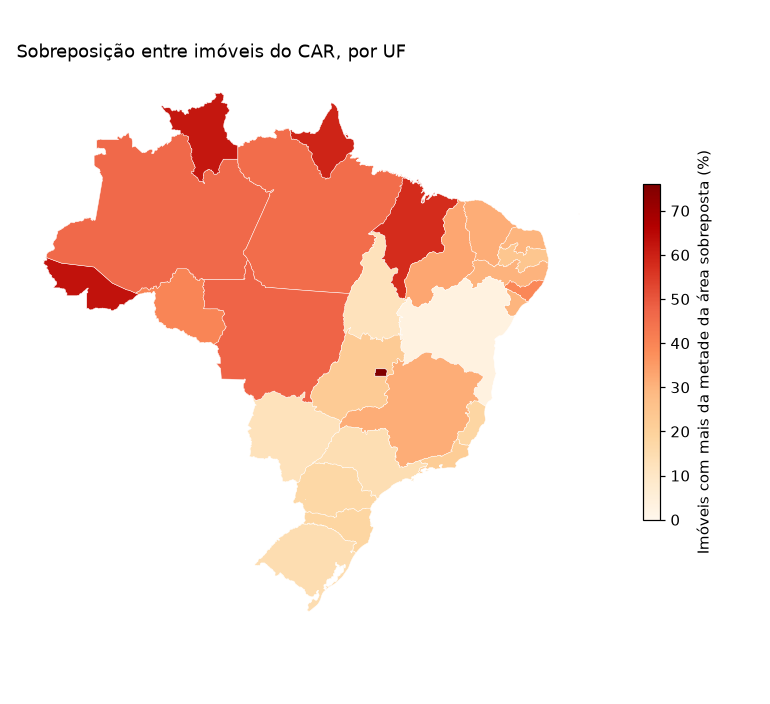
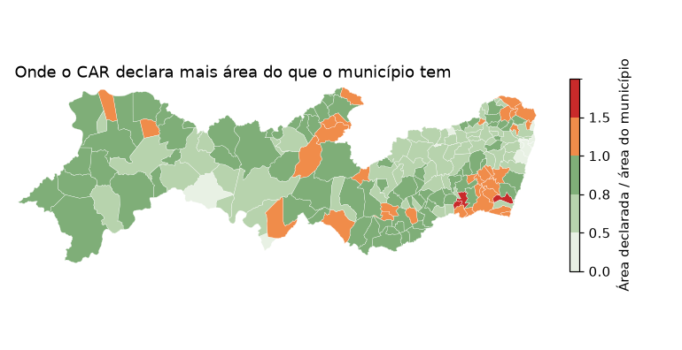
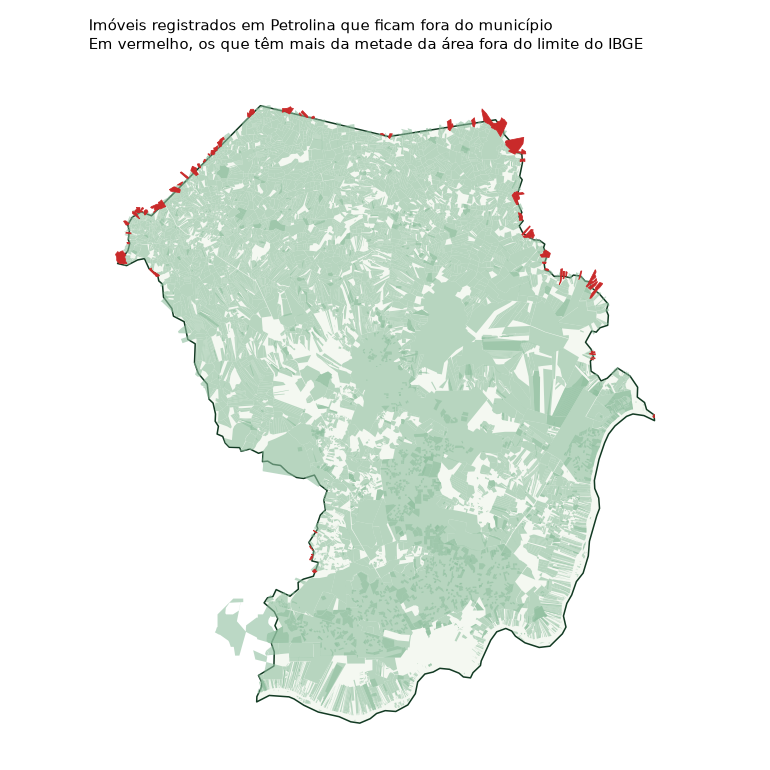

# Inconsistências do cadastro

O CAR é **autodeclarado**: quem desenha o perímetro e informa os dados é o próprio
declarante, e a conferência vem depois, na análise. Enquanto ela não chega, o cadastro
guarda sobreposições, imóveis fora do município informado e áreas que não fecham com o
território. Este guia mostra como encontrar essas inconsistências com o `carbr`, do
país até um município.

Nada aqui é juízo sobre um imóvel em particular: são sinais para orientar a análise e
para quem usa os dados saber o que tem em mãos.

```python
import carbr
import geopandas as gpd


def ibge_mesh(path):
    url = ("https://servicodados.ibge.gov.br/api/v3/malhas/" + path
           + "formato=application/vnd.geo%2Bjson&qualidade=intermediaria")
    return gpd.read_file(url).to_crs(4674)
```

## O que a carga já registra

Ao republicar os dados, o `carbr` anota no catálogo o que encontrou em cada UF:
geometrias inválidas (com autointerseção, por exemplo) e imóveis cujo código começa
com a sigla de outra UF. As inválidas ficam na publicação, marcadas na coluna
`geometry_valid`.

```python
cat = carbr.car_catalog()
print(cat[["invalid_geometries", "registered_in_other_state"]].sum())

cat.sort_values("invalid_geometries", ascending=False)[
    ["state", "properties", "invalid_geometries", "registered_in_other_state"]
].head(6)
```

```text
invalid_geometries           2748
registered_in_other_state      29
dtype: int64
   state  properties  invalid_geometries  registered_in_other_state
10    MG     1185013                 597                          0
25    SP      474172                 498                          0
8     GO      245524                 210                          4
17    PR      559480                 185                          0
11    MS       90552                 156                          0
23    SC      437300                 134                          0
```

## O país inteiro: sobreposição e imóveis fora do município

Dois sinais são calculados na publicação para cada imóvel não cancelado, e ficam
prontos para consulta: a parcela da área sobreposta a outros imóveis do estado e a
parcela que fica fora do município declarado. `car_quality_summary()` traz o resumo
por município; somando por UF:

```python
quality = carbr.car_quality_summary()
by_state = quality.groupby("state")[["properties", "overlapping_half", "outside_half"]].sum()
by_state["share_overlapping"] = (100 * by_state["overlapping_half"] / by_state["properties"]).round(1)
by_state["share_outside"] = (100 * by_state["outside_half"] / by_state["properties"]).round(2)
total = by_state["properties"].sum()
print(f"{100 * by_state['overlapping_half'].sum() / total:.0f}% dos imóveis com mais da metade da área sobreposta;",
      f"{by_state['outside_half'].sum()} com mais da metade fora do município")

by_state.sort_values("share_overlapping", ascending=False).head(10)
```

```text
25% dos imóveis com mais da metade da área sobreposta; 117303 com mais da metade fora do município
       properties  overlapping_half  outside_half  share_overlapping  share_outside
state                                                                              
DF          20826             15830            10               76.0           0.05
AC          57680             36265           294               62.9           0.51
RR          27139             16801           215               61.9           0.79
AP          16906              9983           192               59.1           1.14
MA         414258            238954          8819               57.7           2.13
MT         206064             97781          3397               47.5           1.65
AM          95521             44325           780               46.4           0.82
PA         345391            157621          2513               45.6           0.73
RO         188779             75054          1790               39.8           0.95
AL         141643             55653          3422               39.3           2.42
```

A diferença entre os estados é grande:

```python
UFS = {"11": "RO", "12": "AC", "13": "AM", "14": "RR", "15": "PA", "16": "AP", "17": "TO", "21": "MA",
       "22": "PI", "23": "CE", "24": "RN", "25": "PB", "26": "PE", "27": "AL", "28": "SE", "29": "BA",
       "31": "MG", "32": "ES", "33": "RJ", "35": "SP", "41": "PR", "42": "SC", "43": "RS", "50": "MS",
       "51": "MT", "52": "GO", "53": "DF"}
states = ibge_mesh("paises/BR?intrarregiao=UF&")
states["state"] = states["codarea"].map(UFS)
states = states.merge(by_state.reset_index(), on="state", how="left")

ax = states.plot(column="share_overlapping", cmap="OrRd", vmin=0, edgecolor="white", linewidth=0.3,
                 figsize=(7, 6.4), legend=True,
                 legend_kwds={"shrink": 0.5, "label": "Imóveis com mais da metade da área sobreposta (%)"})
ax.set_title("Sobreposição entre imóveis do CAR, por UF", loc="left")
ax.set_axis_off()

fig("brasil")
```



Sobreposição não é sinônimo de disputa: entra na conta o mesmo imóvel declarado duas
vezes e o lote que fica dentro de um assentamento. É um sinal de onde a análise tem
mais a conferir. Os municípios com mais casos:

```python
quality.sort_values("overlapping_half", ascending=False)[
    ["state", "municipality", "properties", "overlapping_half", "outside_half"]
].head(6)
```

```text
     state        municipality  properties  overlapping_half  outside_half
5562    DF            Brasília       20826             15830            10
16      RO         Porto Velho       23819             14018            53
2639    MG            Januária       12397              9113            90
500     MA              Caxias       10714              7716           154
215     PA              Marabá        9638              7454            56
12      RO  Machadinho D'Oeste        8895              7100            37
```

`car_quality()` desce ao imóvel. Mais adiante, este guia refaz a conta de um município
passo a passo, para mostrar de onde os números vêm.

## O código diz um município, o cadastro diz outro

O código do imóvel traz o município em que ele foi registrado (`UF-0000000-…`). Em
Pernambuco, comparando com a coluna `municipality_code`:

```python
moved = carbr.car_tbl("PE").filter(
    "substr(property_code, 4, 7) <> municipality_code::VARCHAR"
).project("property_code, municipality, area_ha").df()
print(len(moved), "imóveis")

moved["municipality"].value_counts().head(6)
```

```text
1138 imóveis
municipality
Araripina    106
Trindade     102
Pedra         79
Itaíba        47
Itapetim      25
Ouricuri      25
Name: count, dtype: int64
```

Nem todo caso é erro — imóveis mudam de município quando a base municipal é
atualizada —, mas é uma lista curta para conferir.

## Mais área declarada do que território

Somando a área declarada dos imóveis de cada município e dividindo pela área do
município na malha do IBGE, o resultado não deveria passar de 1. Passa em vários.

```python
mesh = ibge_mesh("estados/PE?intrarregiao=municipio&")
mesh["municipality_code"] = mesh["codarea"].astype(int)
mesh["territory_ha"] = mesh.to_crs(6933).area / 1e4  # projeção de área igual

ratio = mesh.merge(carbr.car_municipalities("PE"), on="municipality_code", how="left")
ratio["ratio"] = ratio["area_ha"] / ratio["territory_ha"]
print((ratio["ratio"] > 1).sum(), "de", len(ratio), "municípios com mais área declarada que território")

ratio.sort_values("ratio", ascending=False)[
    ["municipality", "properties", "area_ha", "territory_ha", "ratio"]
].head(6).round(2)
```

```text
36 de 185 municípios com mais área declarada que território
    municipality  properties   area_ha  territory_ha  ratio
46       Catende      1289.0  42584.42      20749.68   2.05
88      Jaqueira      1203.0  16282.03       8736.33   1.86
134  Rio Formoso       776.0  37161.96      22835.97   1.63
52        Cortês       756.0  14886.64      10283.63   1.45
128    Primavera       620.0  16194.58      11197.19   1.45
133     Ribeirão       799.0  39828.67      29096.37   1.37
```

A concentração na Zona da Mata sugere sobreposição sistemática entre imóveis, não
erro isolado.

```python
from matplotlib.colors import BoundaryNorm, ListedColormap

cmap = ListedColormap(["#e8f1e4", "#b7d3ad", "#7fae78", "#f08c4a", "#c92a2a"])
norm = BoundaryNorm([0, 0.5, 0.8, 1, 1.5, 10], cmap.N)
ax = ratio.plot(column="ratio", cmap=cmap, norm=norm, edgecolor="white", linewidth=0.2,
                figsize=(7, 3.6), legend=True,
                legend_kwds={"shrink": 0.6, "ticks": [0, 0.5, 0.8, 1, 1.5],
                             "label": "Área declarada / área do município"},
                missing_kwds={"color": "#d9d9d9"})
ax.set_xlim(-41.4, -34.8)
ax.set_ylim(-9.5, -7.25)
ax.set_title("Onde o CAR declara mais área do que o município tem", loc="left")
ax.set_axis_off()

fig("razao")
```



## Dentro de um município: Petrolina

Com os perímetros, dá para ir ao detalhe. Os imóveis não cancelados de Petrolina e o
limite do município, em coordenadas planas para medir em hectares:

```python
petrolina = carbr.car_properties("PE", municipality="Petrolina")
petrolina = petrolina[(petrolina["status"] != "cancelled") & petrolina["geometry_valid"]]
utm = petrolina.to_crs(31984).reset_index(drop=True)
boundary = mesh[mesh["codarea"] == "2611101"].to_crs(31984)

len(utm)
```

```text
10849
```

### Imóveis fora do município

Recortando cada imóvel pelo limite do município, sai a parcela da área que fica do
lado de fora. Faixas estreitas na divisa são esperadas, porque o traçado do IBGE e o
do declarante nunca coincidem; o sinal é o imóvel com mais da metade da área fora.

```python
inside_ha = utm.intersection(boundary.geometry.iloc[0]).area / 1e4
utm["geometry_ha"] = utm.area / 1e4
utm["outside"] = (1 - inside_ha / utm["geometry_ha"]) > 0.5

print(utm["outside"].sum(), "imóveis,", round(utm.loc[utm["outside"], "area_ha"].sum()), "hectares")
```

```text
90 imóveis, 3359 hectares
```

```python
ax = boundary.plot(color="#f4f8f1", edgecolor="#123a23", linewidth=1, figsize=(7, 7))
utm[~utm["outside"]].plot(ax=ax, color="#8fbf9f", alpha=0.6)
utm[utm["outside"]].plot(ax=ax, color="#c92a2a", edgecolor="#c92a2a", linewidth=0.5)
ax.set_title("Imóveis registrados em Petrolina que ficam fora do município\n"
             "Em vermelho, os que têm mais da metade da área fora do limite do IBGE",
             loc="left", fontsize=10)
ax.set_axis_off()

fig("fora")
```



### Sobreposições

Uma junção espacial do conjunto com ele mesmo, com o predicado `overlaps`, aponta
para cada imóvel os outros com que ele divide área (tocar na divisa não conta).

```python
pairs = gpd.sjoin(utm[["property_code", "geometry"]], utm[["geometry"]], predicate="overlaps")
utm["neighbours"] = pairs.groupby(level=0).size().reindex(utm.index, fill_value=0)
summed_ha = utm["geometry_ha"].sum()
covered_ha = utm.union_all().area / 1e4

print(f"{(utm['neighbours'] > 0).sum()} de {len(utm)} imóveis sobrepõem ao menos um vizinho")
print(f"soma das áreas: {summed_ha:.0f} ha; área coberta: {covered_ha:.0f} ha; "
      f"contado em dobro: {summed_ha - covered_ha:.0f} ha")
```

```text
8462 de 10849 imóveis sobrepõem ao menos um vizinho
soma das áreas: 408603 ha; área coberta: 367152 ha; contado em dobro: 41451 ha
```

A maioria das sobreposições são faixas estreitas na divisa. Os casos que mais pesam
são poucos:

```python
utm.sort_values("neighbours", ascending=False)[
    ["property_code", "area_ha", "fiscal_modules", "size_class", "neighbours"]
].head(6)
```

```text
                                    property_code     area_ha  fiscal_modules size_class  \
2070  PE-2611101-588BC484570D440484F527F07DF5AFFA  81578.6042          0.5209      small   
3526  PE-2611101-5316F05D569C41C4847C52AF2C7E5CCB   6647.5275          0.6230      small   
3682  PE-2611101-5149DB80F9E54FDDB445BDC40DF501AF    360.5831          6.5561     medium   
5330  PE-2611101-0B75BD9F97224B73A761792FC4095A9C    305.9185          5.5622     medium   
38    PE-2611101-961DA0E4B2FA4FA6BA6601588C06310A    143.0881          2.5394      small   
5329  PE-2611101-CB1BE273577643AD9BC07FB09008FB34    305.8473          5.5609     medium   

      neighbours  
2070         325  
3526          49  
3682          41  
5330          40  
38            26  
5329          26
```

### "Pequeno" nem sempre é pequeno

O porte (`size_class`) vem dos módulos fiscais informados pelo Sicar, não da área. Em
assentamentos e territórios de povos e comunidades tradicionais, um único cadastro
cobre muitas famílias, e um perímetro de milhares de hectares aparece com menos de
quatro módulos. Em Pernambuco, os imóveis "pequenos" com mais de 440 hectares — quatro
vezes o maior módulo fiscal do país:

```python
carbr.car_tbl("PE").filter("size_class = 'small' AND area_ha > 440").aggregate(
    "property_type, count(*) AS properties, round(sum(area_ha)) AS area_ha"
).df()
```

```text
           property_type  properties   area_ha
0             settlement         432  651693.0
1  traditional_community          65  164138.0
2         rural_property           1     926.0
```

Quem conta "pequenos produtores" pelo porte deve separar o tipo do imóvel
(`property_type`) antes.

## O que fazer com isso

Cada sinal acima vira uma lista de imóveis: `property_code` leva ao cadastro, e
`car_property()` devolve o perímetro. Para repetir a análise em outro município ou
outra UF, basta trocar os argumentos.
