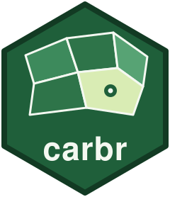

# carbr




Os imóveis rurais declarados no **Cadastro Ambiental Rural (CAR)** no Python, sem
baixar a base inteira.

O `carbr` lê uma republicação dos dados públicos do Sicar em GeoParquet. Cada
consulta — por UF, município, situação, porte, retângulo, ponto ou código do
imóvel — transfere só os trechos do arquivo de que precisa, e não passa pelos
servidores do Sicar.


## Instalação

```bash
pip install "carbr[geo] @ git+https://github.com/StrategicProjects/carbr-py"
```

Sem o extra `geo`, a geometria vem em WKB e `car_at()` não está disponível.

## Uso

```python
import carbr

carbr.car_catalog()                       # UFs publicadas, versão e qualidade da carga
carbr.car_municipalities("PE")            # resumo por município

# Imóveis grandes de Petrolina, como GeoDataFrame
carbr.car_properties("PE", municipality="Petrolina", size_class="large")

# Cadastros pendentes do estado, sem transferir a geometria
carbr.car_properties("PE", status="pending", geometry=False)

carbr.car_at(lon=-40.5, lat=-9.2)         # que imóveis estão declarados neste ponto?
carbr.car_property("PE-2611101-588BC484570D440484F527F07DF5AFFA")

# Qualquer outra consulta, direto no arquivo remoto
carbr.car_tbl("PE").aggregate("status, size_class, count(*) AS n").df()
```

## Os dados

- **Origem:** serviço público do Sicar, do Serviço Florestal Brasileiro. O cadastro é
  autodeclarado: há sobreposições entre imóveis, e a presença no CAR não comprova domínio.
- **Conteúdo:** o perímetro declarado e dez atributos de cada imóvel. Não há dado pessoal.
- **Cobertura:** por enquanto, Pernambuco. `car_catalog()` mostra o que está publicado e a data.
- **Endereço:** o padrão é um bucket público; `carbr.set_base_url()` ou a variável `CAR_URL`
  apontam para um espelho compatível com S3 ou para uma pasta local.

As mesmas funções existem em R: [carbr-r](https://github.com/StrategicProjects/carbr-r).

## Licença

Código sob licença MIT. Os dados são do Sicar; use `car_cite()` para citá-los.
