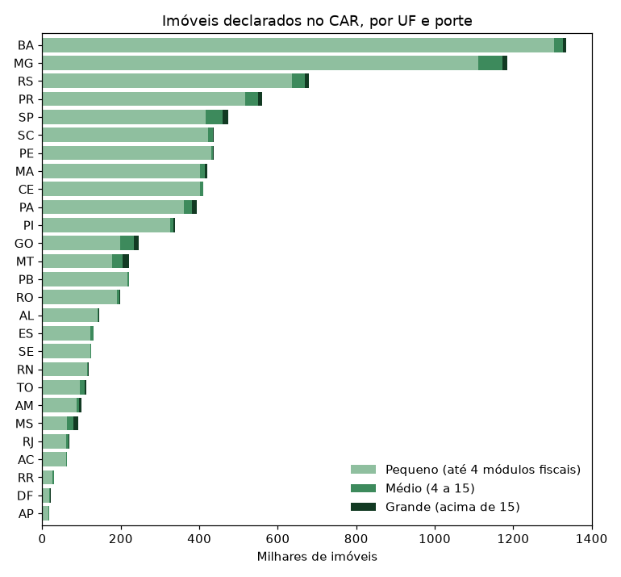
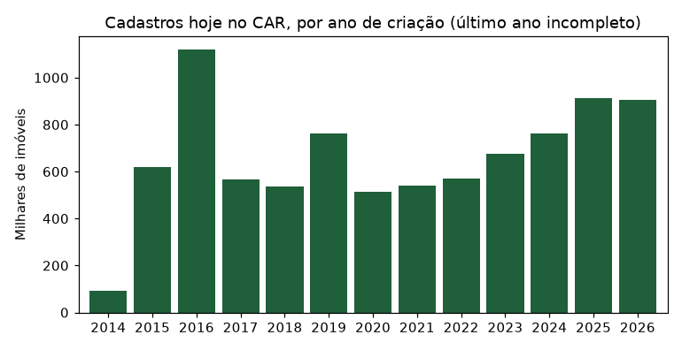
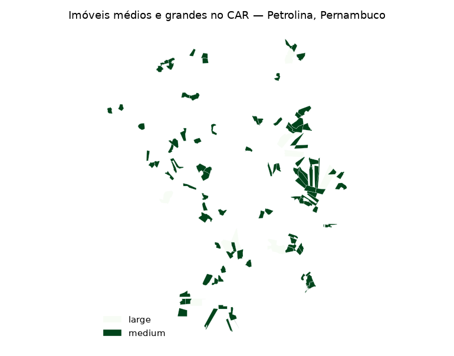

# Primeiros passos

O **Cadastro Ambiental Rural (CAR)** é o registro público eletrônico dos imóveis
rurais do país, criado pelo Código Florestal (Lei nº 12.651/2012) e mantido no Sicar
pelo Serviço Florestal Brasileiro. O `carbr` lê uma republicação dos dados públicos
do cadastro em GeoParquet, com as 27 UFs e cerca de 8,6 milhões de imóveis. Cada
consulta transfere só os trechos do arquivo de que precisa, sem baixar a base de um
estado inteiro e sem passar pelos servidores do Sicar.

| Função | Para quê |
|---|---|
| `car_catalog()` | O que está publicado |
| `car_dictionary()` | O que cada coluna significa |
| `car_summary()` | Totais pré-calculados, do estado ou do país |
| `car_municipalities()` | Resumo por município |
| `car_properties()` | Imóveis de uma UF, com filtros |
| `car_property()` | Um imóvel pelo código |
| `car_at()` | Imóveis que contêm um ponto |
| `car_tbl()` | Relação preguiçosa do DuckDB |
| `car_cite()` | Como citar |

## O que está publicado

`car_catalog()` traz uma linha por UF, com o número de imóveis e os indicadores de
qualidade da carga. A versão é a data da última atualização da publicação.

```python
import carbr

cat = carbr.car_catalog()
print(cat.attrs["version"], "-", len(cat), "UFs,", cat["properties"].sum(), "imóveis")

cat.head(6)
```

```text
2026-11-25 - 27 UFs, 8578061 imóveis
  state  properties  municipalities  invalid_geometries  null_geometries  \
0    AC       63349              22                  19                0   
1    AL      143973             102                  19                0   
2    AM       99056              62                  94                0   
3    AP       17834              16                   2                0   
4    BA     1334593             416                   2                0   
5    CE      410650             184                  56                0   

   registered_in_other_state  
0                          0  
1                          5  
2                          0  
3                          0  
4                          1  
5                          3
```

O dicionário de dados diz o que é cada coluna e qual era o seu nome no Sicar.

```python
print(carbr.car_dictionary().to_string(index=False))
```

```text
            column         sicar_name                                                                      description
     property_code         cod_imovel                       Código do imóvel no CAR (UF-município IBGE-identificador).
       status_code      status_imovel          Situação do cadastro: AT ativo, PE pendente, SU suspenso, CA cancelado.
            status                NaN                       Situação do cadastro por extenso, derivada de status_code.
         condition           condicao              Etapa da análise em que o cadastro está, como informada pelo Sicar.
property_type_code        tipo_imovel        IRU imóvel rural, AST assentamento, PCT povos e comunidades tradicionais.
     property_type                NaN                      Tipo do imóvel por extenso, derivado de property_type_code.
        created_at        dat_criacao                                        Data e hora de criação do cadastro (UTC).
           area_ha               area                                           Área declarada do imóvel, em hectares.
    fiscal_modules           m_fiscal                                            Área em módulos fiscais do município.
        size_class                NaN        small até 4 módulos fiscais, medium acima de 4 até 15, large acima de 15.
             state                 uf                                                UF onde o imóvel está localizado.
      municipality          municipio                                         Município onde o imóvel está localizado.
 municipality_code cod_municipio_ibge                                            Código IBGE do município (7 dígitos).
registration_state                NaN                           UF do prefixo de property_code; pode diferir de state.
               lon                NaN                            Longitude de um ponto dentro do imóvel (SIRGAS 2000).
               lat                NaN                             Latitude de um ponto dentro do imóvel (SIRGAS 2000).
    geometry_valid                NaN                     Se a geometria declarada é válida (sem autointerseção etc.).
              xmin                NaN Limite oeste do retângulo envolvente do imóvel, para filtro espacial na leitura.
              ymin                NaN                                              Limite sul do retângulo envolvente.
              xmax                NaN                                            Limite leste do retângulo envolvente.
              ymax                NaN                                            Limite norte do retângulo envolvente.
          geometry    geo_area_imovel         Perímetro declarado do imóvel, WKB, EPSG:4674. Nulo se o Sicar não traz.
```

## O país inteiro, sem ler os imóveis

`car_summary()` lê tabelas pequenas, calculadas na publicação, com a contagem de
imóveis e a área declarada por UF, situação, porte, tipo, etapa da análise e ano de
criação do cadastro. O argumento `by` escolhe as dimensões; `None` dá o total.

```python
print(carbr.car_summary(None))

carbr.car_summary("size_class")
```

```text
   properties       area_ha
0     8578061  8.161304e+08
  size_class  properties       area_ha
0      large      142974  4.105518e+08
1     medium      398351  1.339702e+08
2      small     8036736  2.716083e+08
```

Os pequenos imóveis, de até quatro módulos fiscais, são mais de nove em cada dez
cadastros e um terço da área declarada. Por UF:

```python
by_state = carbr.car_summary(["state", "size_class"])
wide = by_state.pivot(index="state", columns="size_class", values="properties").fillna(0)
wide = wide.loc[wide.sum(axis=1).sort_values().index, ["small", "medium", "large"]] / 1e3
wide.columns = ["Pequeno (até 4 módulos fiscais)", "Médio (4 a 15)", "Grande (acima de 15)"]

ax = wide.plot.barh(stacked=True, figsize=(7, 6.5), width=0.8,
                    color=["#8fbf9f", "#3d8a5c", "#123a23"])
ax.set_title("Imóveis declarados no CAR, por UF e porte")
ax.set_xlabel("Milhares de imóveis")
ax.set_ylabel("")
ax.legend(frameon=False, loc="lower right")

fig("estados")
```



A etapa da análise mostra onde o cadastro está parado:

```python
cond = carbr.car_summary("condition").sort_values("properties", ascending=False)
cond["share"] = (100 * cond["properties"] / cond["properties"].sum()).round(1)

print(cond[["condition", "properties", "share"]].head(8).to_string(index=False))
```

```text
                                                                 condition  properties  share
                                                        Aguardando análise     5978543   69.7
                           Analisado, aguardando atendimento a notificação     1309315   15.3
                       Analisado, em conformidade com a Lei nº 12.651/2012      460502    5.4
Analisado, em conformidade com a Lei nº 12.651/2012, com ativos ambientais      191767    2.2
        Analisado, aguardando regularização ambiental (Lei nº 12.651/2012)      189447    2.2
                                      Cancelado por decisão administrativa      161970    1.9
            Aguardando análise, após revisão ou atendimento da notificação      134338    1.6
                                                                Em análise      109335    1.3
```

E o ano de criação dá a linha do tempo do cadastramento:

```python
years = carbr.car_summary("created_year")
ax = (years.set_index("created_year")["properties"] / 1e3).plot.bar(
    figsize=(7, 3.6), color="#1f5f3a", width=0.85, rot=0)
ax.set_title("Cadastros hoje no CAR, por ano de criação (último ano incompleto)")
ax.set_xlabel("")
ax.set_ylabel("Milhares de imóveis")

fig("anos")
```



As dimensões combinam, e `state` restringe a uma ou mais UFs:

```python
carbr.car_summary(["status", "size_class"], state=["PE", "BA"])
```

```text
       status size_class  properties       area_ha
0      active      large        8236  1.551131e+07
1      active     medium       27968  9.622438e+06
2      active      small     1725262  2.374194e+07
3   cancelled      large         164  7.603320e+05
4   cancelled     medium         250  9.443897e+04
5   cancelled      small        4541  2.322470e+05
6     pending      large         222  4.876561e+05
7     pending     medium         420  1.372095e+05
8     pending      small        3669  8.763069e+04
9   suspended      large          13  6.799360e+04
10  suspended     medium           8  2.958711e+03
11  suspended      small          30  2.372574e+03
```

## Resumo por município

O resumo municipal também é pré-calculado. Sem argumento, traz os municípios de
todas as UFs.

```python
mun = carbr.car_municipalities()

mun.sort_values("properties", ascending=False)[
    ["state", "municipality", "properties", "small_properties", "area_ha", "pending"]
].head(6)
```

```text
     state       municipality  properties  small_properties       area_ha  pending
16      RO        Porto Velho       25819             24145  3.296893e+06     5446
2083    BA        Monte Santo       24609             24541  1.889741e+05        0
5563    DF           Brasília       21049             17597  1.202233e+06      135
2122    BA       Pilão Arcado       16403             16241  1.061906e+06        1
1476    PE          Araripina       15663             15625  1.874233e+05        1
1951    BA  Euclides da Cunha       14962             14892  1.357437e+05       44
```

## Imóveis de um município

Os filtros de `car_properties()` são aplicados antes da leitura. Aqui, os imóveis
médios e grandes de Petrolina, em Pernambuco — algumas centenas, de um arquivo com
mais de 400 mil. Com o extra `geo` instalado, o resultado é um GeoDataFrame em
SIRGAS 2000.

```python
petrolina = carbr.car_properties(
    "PE", municipality="Petrolina", size_class=["medium", "large"]
)

petrolina[["property_code", "status", "area_ha", "fiscal_modules", "size_class"]].head(6)
```

```text
                                 property_code  status   area_ha  fiscal_modules size_class
0  PE-2611101-111805B2DFBA4AF7B2BE2458D8CE27FD  active  652.4604         11.6057     medium
1  PE-2611101-B095898582B2428EBDD3200C7CA25992  active  245.1787          4.4578     medium
2  PE-2611101-69A386072C4E4D3189F24800452142C1  active  245.5974          4.4654     medium
3  PE-2611101-C283CE3BF96A440DBE8D9026B91FC2C1  active  534.9252          9.7259     medium
4  PE-2611101-ADEC18D9D8EA4CB6B5A3F56074EA0B63  active  432.0721          7.8559     medium
5  PE-2611101-03F43B55FBE64453A6F2F740902D02CB  active  803.5238         14.6095     medium
```

```python
ax = petrolina.plot(
    column="size_class", categorical=True, legend=True, figsize=(7, 5.5),
    cmap="Greens", edgecolor="white", linewidth=0.2,
    legend_kwds={"loc": "lower left", "frameon": False},
)
ax.set_title("Imóveis médios e grandes no CAR — Petrolina, Pernambuco")
ax.set_axis_off()

fig("petrolina")
```



O município pode ser dado pelo nome (sem diferenciar maiúsculas nem acentos) ou pelo
código IBGE de sete dígitos. Os outros filtros são `status`, `property_type` e `bbox`.

## Sem a geometria

A geometria é a parte pesada do arquivo. Quando só os atributos interessam,
`geometry=False` deixa de transferi-la. Os cadastros pendentes de Pernambuco, por
município:

```python
pending = carbr.car_properties("PE", status="pending", geometry=False)

pending["municipality"].value_counts().head(6)
```

```text
municipality
Carnaubeira da Penha    145
Floresta                104
Águas Belas              59
Pesqueira                35
Jatobá                   28
Tupanatinga              23
Name: count, dtype: int64
```

## Que imóveis estão declarados aqui?

`car_at()` devolve os imóveis que contêm um ponto, procurando em todas as UFs (ou só
nas de `state`). Como o cadastro é autodeclarado, sobreposições são comuns e o
resultado pode ter mais de uma linha, como neste ponto do Distrito Federal:

```python
here = carbr.car_at(lon=-47.9, lat=-15.8, geometry=False)

print(here[["property_code", "municipality", "area_ha", "status", "condition"]].T)
```

```text
                                                         0  \
property_code  DF-5300108-AB840D7B499B43E69C3D999165FF2475   
municipality                                      Brasília   
area_ha                                         94378.9674   
status                                           cancelled   
condition             Cancelado por decisão administrativa   

                                                         1  
property_code  DF-5300108-1274A9532343473DB7413440C0ABF8AD  
municipality                                      Brasília  
area_ha                                        103414.5148  
status                                           cancelled  
condition             Cancelado por decisão administrativa
```

## Um imóvel pelo código

```python
one = carbr.car_property("PE-2611101-588BC484570D440484F527F07DF5AFFA", geometry=False)

print(one.T)
```

```text
                                                              0
property_code       PE-2611101-588BC484570D440484F527F07DF5AFFA
status_code                                                  AT
status                                                   active
condition                                    Aguardando análise
property_type_code                                          AST
property_type                                        settlement
created_at                     2026-02-13 13:21:54.947000-03:00
area_ha                                              81578.6042
fiscal_modules                                           0.5209
size_class                                                small
state                                                        PE
municipality                                          Petrolina
municipality_code                                       2611101
registration_state                                           PE
lon                                                  -40.550236
lat                                                   -9.131521
geometry_valid                                             True
xmin                                                 -40.824844
ymin                                                  -9.398057
xmax                                                 -40.298282
ymax                                                  -8.864982
```

## Consultas próprias

Para o que `car_summary()` não cobre, `car_tbl()` devolve uma relação preguiçosa do
DuckDB sobre os arquivos publicados. Nada é lido até o `.df()`, e a consulta roda
sobre o arquivo remoto lendo só as colunas usadas. Convém restringir a uma UF: sobre
o país inteiro, uma agregação lê colunas de 8,6 milhões de linhas e leva minutos.

```python
carbr.car_tbl("PE").filter("fiscal_modules > 15 AND status = 'active'").aggregate(
    "municipality, count(*) AS properties, round(sum(area_ha)) AS area_ha"
).order("area_ha DESC").limit(5).df()
```

```text
               municipality  properties  area_ha
0  Santa Maria da Boa Vista           7  44671.0
1             Serra Talhada          17  33847.0
2                  Floresta          25  33767.0
3                  Ibimirim          22  32990.0
4                  Tacaratu          12  32455.0
```

## Como citar

```python
text = carbr.car_cite()
```

```text
Serviço Florestal Brasileiro. Sistema Nacional de Cadastro Ambiental Rural (Sicar): imóveis rurais. Dados organizados pelo CastLab/UFPE (pacote carbr), versão 2026-11-25.
```

## Endereço dos dados e cache

O pacote lê de um bucket público. Para usar um espelho compatível com S3 ou uma cópia
local da publicação, chame `carbr.set_base_url()` ou defina a variável de ambiente
`CAR_URL`. O catálogo e os resumos ficam em cache em `carbr.car_cache_dir()`, e o
catálogo vale por seis horas (`car_catalog(refresh=True)` o relê); os imóveis nunca
são copiados para o disco.
