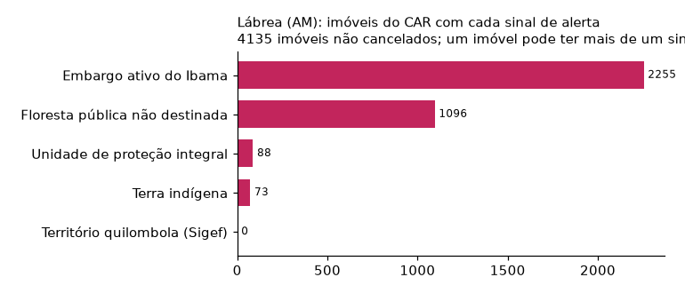
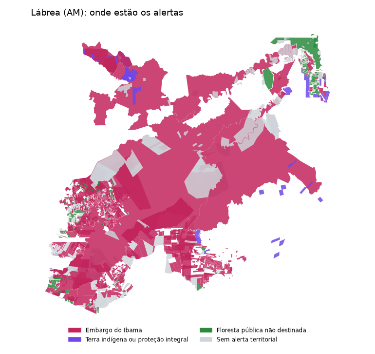
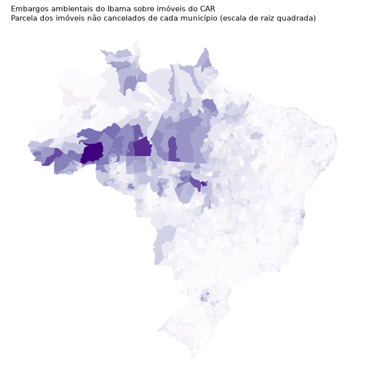
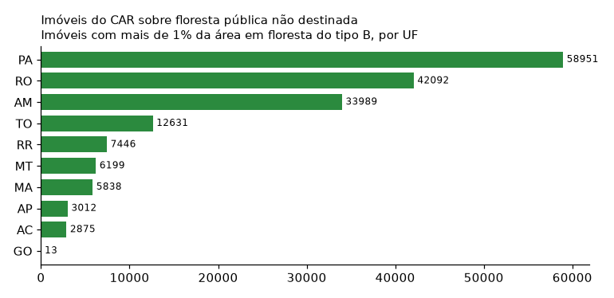

# Triagem para crédito e conformidade

Antes de conceder crédito rural, o banco confere se o imóvel tem algum dos impedimentos
sociais, ambientais e climáticos que o Manual de Crédito Rural lista (capítulo 2, seção
9). Vários deles são perguntas de mapa: o imóvel está sobre terra indígena? Sobre unidade
de conservação? Tem embargo ambiental? Está em floresta pública que ainda não foi
destinada?

O dono do imóvel faz essa conferência no Meu Imóvel Rural, um imóvel por vez. Este guia
mostra como fazê-la **em lote**, para uma carteira ou para um município inteiro, com
`car_check()` e `car_quality()`.

## Uma lista de imóveis de uma vez

`car_check()` recebe os códigos e devolve, para cada um, o que consta na camada pública e
um resultado: `"ok"`, `"attention"`, `"blocked"`, `"not_found"` ou `"invalid"`. A nota diz
o motivo em português.

```python
import carbr
import matplotlib.pyplot as plt

labrea = carbr.car_properties("AM", municipality="Lábrea", geometry=False)
check = carbr.car_check(labrea["property_code"])
check["check"].value_counts()
```

```python
for note in check.loc[check["check"] == "attention", "note"].head(4):
    print(note)
```

```text
Analisado, com notificação sem resposta do declarante.
Analisado, com notificação sem resposta do declarante.
Analisado, com notificação sem resposta do declarante.
Analisado, com notificação sem resposta do declarante.
```

Lábrea, no sul do Amazonas, foi escolhido de propósito: é um dos municípios com mais
embargos do país. A consulta leva poucos segundos, porque lê só os blocos do município.

## O que pesa em cada caso

A classificação junta vários sinais. `car_quality()` traz cada um em separado, por imóvel:

```python
quality = carbr.car_quality("AM", municipality="Lábrea")
signals = pd.Series({
    "Território quilombola (Sigef)": (quality["quilombola_share"] >= 0.01).sum(),
    "Terra indígena": (quality["indigenous_share"] >= 0.01).sum(),
    "Unidade de proteção integral": (quality["strict_protection_share"] >= 0.01).sum(),
    "Floresta pública não destinada": (quality["public_forest_share"] >= 0.01).sum(),
    "Embargo ativo do Ibama": (quality["embargo_count"] > 0).sum(),
})

ax = signals.plot.barh(color="#c2255c", figsize=(7, 3), width=0.7)
ax.bar_label(ax.containers[0], padding=3, fontsize=8)
ax.set_title(f"Lábrea (AM): imóveis do CAR com cada sinal de alerta\n"
             f"{len(quality)} imóveis não cancelados; um imóvel pode ter mais de um sinal",
             loc="left", fontsize=10)
ax.spines[["top", "right"]].set_visible(False)

fig("triagem-motivos")
```



No mapa, os mesmos sinais mostram onde o problema está dentro do município:

```python
import numpy as np

shapes = carbr.car_properties("AM", municipality="Lábrea")
shapes = shapes[shapes["status"] != "cancelled"].merge(quality, on="property_code", how="left")
COLOURS = {"Embargo do Ibama": "#c2255c", "Terra indígena ou proteção integral": "#7048e8",
           "Floresta pública não destinada": "#2b8a3e", "Sem alerta territorial": "#ced4da"}
shapes["signal"] = np.select(
    [shapes["embargo_count"] > 0,
     (shapes["indigenous_share"] >= 0.01) | (shapes["strict_protection_share"] >= 0.01),
     shapes["public_forest_share"] >= 0.01],
    list(COLOURS)[:3], default="Sem alerta territorial")

from matplotlib.patches import Patch

ax = shapes.plot(color=shapes["signal"].map(COLOURS), figsize=(7, 6.6), linewidth=0, alpha=0.85)
ax.legend(handles=[Patch(color=c, label=s) for s, c in COLOURS.items()], loc="upper center",
          bbox_to_anchor=(0.5, 0.02), ncol=2, frameon=False, fontsize=8)
ax.set_title("Lábrea (AM): onde estão os alertas", loc="left")
ax.set_axis_off()

fig("triagem-labrea")
```



## O país inteiro, por município

`car_quality_summary()` traz as contagens por município, prontas. Os totais:

```python
towns = carbr.car_quality_summary()
towns[["properties", "embargoed", "public_forest", "strict_protection", "indigenous", "quilombola"]].sum()
```

Os embargos se concentram no arco do desmatamento:

```python
import geopandas as gpd

brazil = gpd.read_file(
    "https://servicodados.ibge.gov.br/api/v3/malhas/paises/BR?intrarregiao=municipio"
    "&formato=application/vnd.geo%2Bjson&qualidade=minima")
brazil["municipality_code"] = brazil["codarea"].astype(int)
brazil = brazil.merge(towns, on="municipality_code", how="left")
brazil["share"] = np.sqrt(100 * brazil["embargoed"] / brazil["properties"])

ax = brazil.plot(column="share", cmap="Purples", figsize=(7, 7), linewidth=0,
                 missing_kwds={"color": "#f1f3f5"})
ax.set_title("Embargos ambientais do Ibama sobre imóveis do CAR\n"
             "Parcela dos imóveis não cancelados de cada município (escala de raiz quadrada)",
             loc="left", fontsize=10)
ax.set_axis_off()

fig("triagem-embargos")
```



```python
top = towns.sort_values("embargoed", ascending=False).head(6)
top.assign(share=(100 * top["embargoed"] / top["properties"]).round(1))[
    ["state", "municipality", "properties", "embargoed", "share"]]
```

As florestas públicas não destinadas, as do "tipo B" do Cadastro Nacional de Florestas
Públicas, são um fenômeno da Amazônia:

```python
forests = towns.groupby("state")["public_forest"].sum()
forests = forests[forests > 0].sort_values()

ax = forests.plot.barh(color="#2b8a3e", figsize=(7, 3.4), width=0.75)
ax.bar_label(ax.containers[0], padding=3, fontsize=8)
ax.set_title("Imóveis do CAR sobre floresta pública não destinada\n"
             "Imóveis com mais de 1% da área em floresta do tipo B, por UF", loc="left", fontsize=10)
ax.set_ylabel("")
ax.spines[["top", "right"]].set_visible(False)

fig("triagem-florestas")
```



## O que a triagem cobre, e o que não cobre

Dos oito impedimentos do manual, cinco estão cobertos por inteiro: a situação do CAR, as
terras indígenas (Funai), as unidades de conservação (CNUC/MMA), os embargos (Ibama) e as
florestas públicas não destinadas (SFB).

Os **territórios quilombolas entram em parte**. O Incra retirou do ar em 2026 a camada
completa, e o que usamos são os territórios já georreferenciados no Sigef. Um alerta de
território quilombola é confiável; a falta dele não garante que o imóvel esteja fora de um.

Ficam de fora a supressão de vegetação nativa, que depende de autorizações sem cadastro
público único, e o trabalho análogo à escravidão, que é uma lista de pessoas: esta base
não tem dado pessoal.

Dois cuidados ao usar o resultado:

- os embargos são só os do Ibama; órgãos estaduais e o ICMBio também embargam;
- tudo parte de perímetros autodeclarados. O resultado é um sinal para a análise, não uma
  conclusão sobre o imóvel, e não substitui a consulta oficial.
